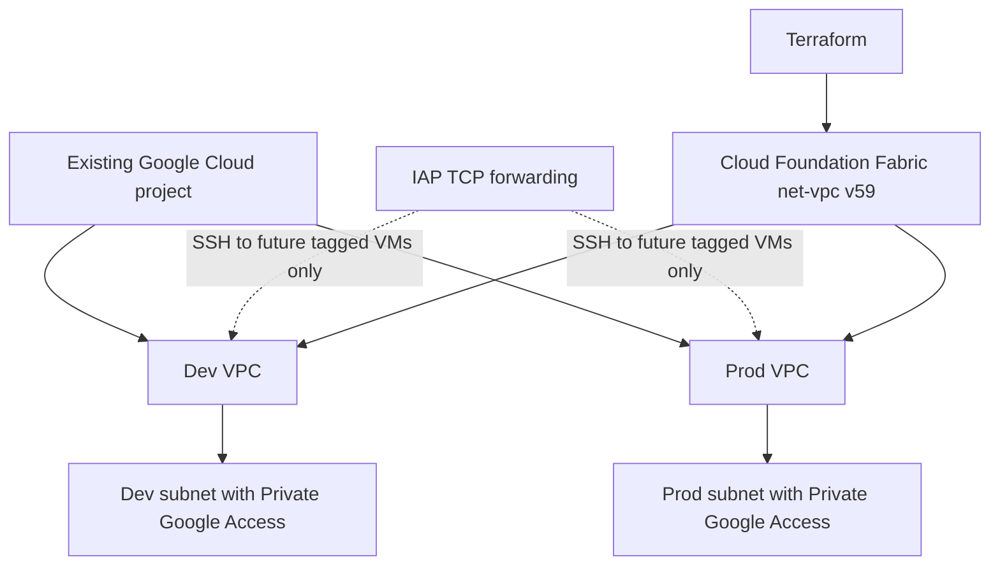

# Google Cloud project foundation with Terraform and Fabric

This project builds a small, reviewable foundation inside **one existing Google Cloud project**. It uses the [Cloud Foundation Fabric](https://github.com/GoogleCloudPlatform/cloud-foundation-fabric) `net-vpc` module pinned to `v59.0.0` and adds a narrowly scoped IAP SSH firewall rule. The design borrows the *separation of environments* idea from the Fabric FAST landing-zone toolkit, but **is not a deployment of the full organization-level FAST framework**.

**Status:** Applied and verified on 1 October 2026 in project `project-7a619bc0-924c-44c4-bab`. A follow-up Terraform plan reported **no changes**. See [validation evidence](VALIDATION.md).

## What it provisions

- Two isolated custom-mode VPCs, `dev` and `prod`, with non-overlapping subnets.
- Private Google Access on each subnet, and unused secondary address ranges reserved for future GKE workloads. No GKE cluster is deployed.
- An SSH ingress rule only from Google's IAP TCP forwarding range and only to instances deliberately tagged `iap-ssh`. No VM is created.
- The Compute Engine API if it is not already enabled.

There is no VM, load balancer, Cloud NAT, public IP, or always-on service in this project. Google Cloud usage can still incur charges depending on project settings and future traffic. Check billing before applying.

## Architecture

See [architecture and security decisions](docs/architecture.md) and the [Mermaid diagram](docs/architecture.mmd).



## Prerequisites

1. An existing Google Cloud project with billing and permissions to enable `compute.googleapis.com` and manage VPCs/firewall rules.
2. Terraform >= 1.12.2 and Google provider credentials. On a local workstation, [Application Default Credentials](https://docs.cloud.google.com/docs/terraform/authentication) are recommended.
3. Git access so Terraform can download the pinned Fabric module.

## Run

```bash
cp terraform.tfvars.example terraform.tfvars
# Edit project_id in terraform.tfvars.
terraform init
terraform fmt -check -recursive
terraform validate
terraform plan -out=foundation.tfplan
terraform apply foundation.tfplan
terraform output
```

This demo uses local Terraform state to keep setup short. Do not use local state for a shared production deployment; migrate to a protected, versioned GCS backend with appropriate IAM and locking controls before team use.

## Verify and clean up

After `apply`, confirm that the `dev` and `prod` VPCs and their subnets exist in the Google Cloud Console. Inspect the firewall rules and check that no compute instances were created. Save redacted screenshots if you want portfolio evidence; never publish credentials or state files.

To remove the created resources:

```bash
terraform destroy
```

The Compute Engine API remains enabled because `disable_on_destroy = false` prevents breaking unrelated resources.

## Scope and trade-offs

This is a **project-level mini-foundation**, not a full enterprise landing zone. It does not create an organization hierarchy, project factory, organization policies, shared VPC, centralized logging, CI/CD or billing controls. Those require organization-level access and additional planning. The [Fabric FAST organization setup](https://github.com/GoogleCloudPlatform/cloud-foundation-fabric/blob/master/fast/stages/0-org-setup/README.md) documents the broader prerequisites.

The configuration intentionally has no open Internet ingress. However, default VPC egress remains allowed, so the project must not be presented as a complete zero-egress security boundary. Private Google Access permits workloads without external IPs to reach supported Google APIs; this project does not itself deploy workloads.

## Validation status

See [VALIDATION.md](VALIDATION.md) for commands run, the actual Google Cloud resources observed, and the post-apply drift check. Terraform state and credentials are intentionally excluded from this repository.
